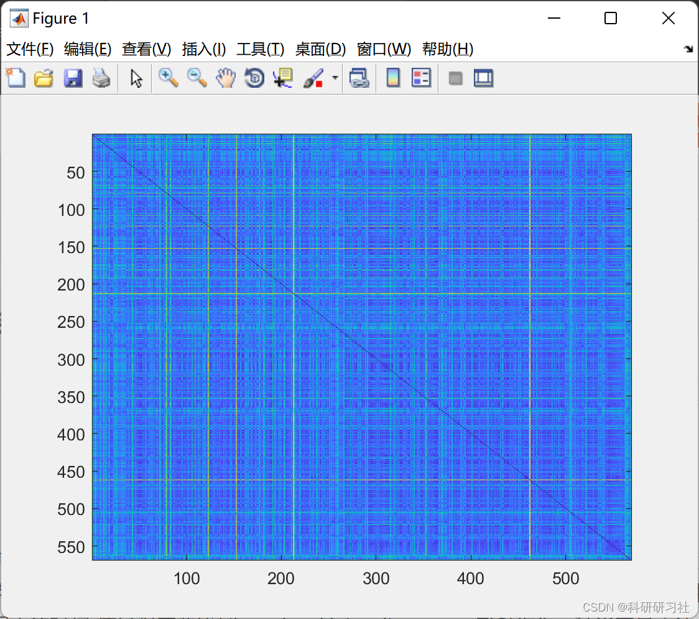
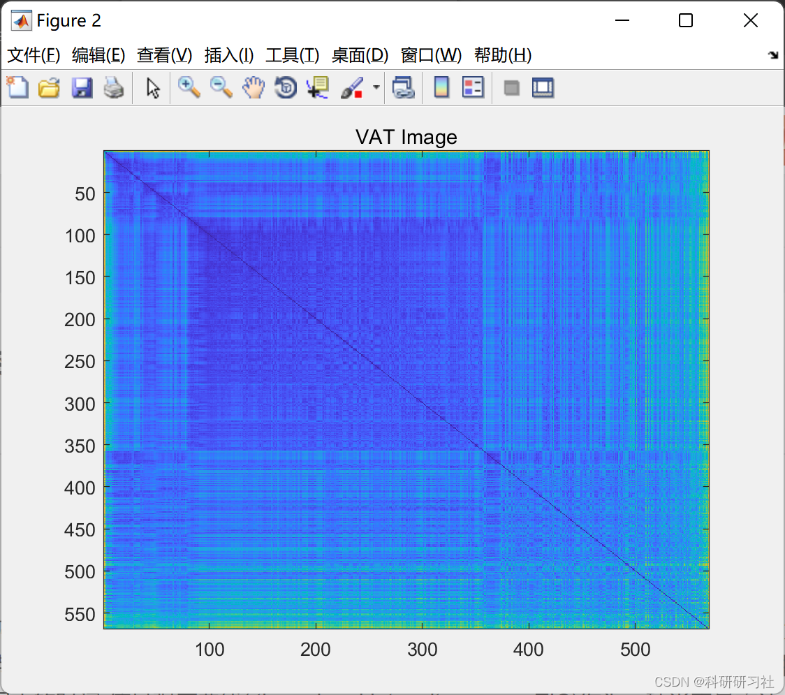
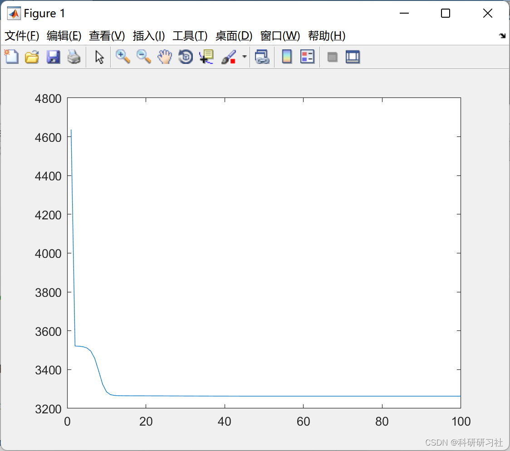

# Analysis of Breast Cancer (Diagnosis) Based on Clustering and Genetic Fuzzy Algorithms (Matlab Code Implementation)

1. Overview
Currently, breast cancer is the most common malignant tumor among women in China. The challenge lies in early diagnosis and differentiation of benign from malignant lesions. MRI, with its high spatial and soft tissue resolution, has been widely used for the early diagnosis of breast cancer. Among them, the time-signal intensity curve (TIC) during dynamic contrast-enhanced MRI can serve as a semi-quantitative method to evaluate the hemodynamic characteristics of lesions, allowing for differentiation between benign and malignant lesions through TIC grading.
This paper explains that an accurate system to analyze breast cancer image data can provide additional confidence for doctors in evaluating patients, and can be used to scan all past scans in clinic databases to identify any patients at risk. Fuzzy logic systems are well suited for building knowledge bases and rule bases that can accurately approximate expert human knowledge, such as that of regular diagnosticians for breast cancer. Genetic algorithms enhance the capabilities of fuzzy logic systems by learning the best membership functions and rule bases using subsets of data, especially when the representative dataset of the given system is available. The combination of these two technologies can be used to develop highly accurate approximations for cancer diagnosis.
2. Run Results
3. Matlab Code Implementation
The code presented here only showcases part of the implementation; the complete code is available in:
Breast Cancer Diagnosis Analysis Based on Clustering and Genetic Fuzzy Algorithms (Matlab Code Implementation)
\nclc\nclf \nclear all\n\nload wbcdnoid.mat\nload dsinfo.mat\n\nK=5; % Number of clusters\n\n% Normalize data\n\nnormwbcd = normalize(wbcd);\n\n% Use fcm function to find K clusters in this data set:\n\n[center,U,objFcn] = fcm(normwbcd,K)\n\n% Plot convergence:\n\nfigure(1)\nplot(objFcn)\n\n% Find which data belong to which cluster:\n\nmaxU = max(U);\nindex1 = find(U(1, :) == maxU);\nindex2 = find(U(2, :) == maxU);\nindex3 = find(U(3, :) == maxU);\nindex4 = find(U(4, :) == maxU);\nindex5 = find(U(5, :) == maxU);\n\n% Sort clusters into their own matrices:\n\nid1 = zeros(length(index1),31);\n\nfor k = 1:length(index1)\n    id1(k,:) = wbcd(index1(k),:);\nend\n\nid2 = zeros(length(index2),31);\n\nfor k = 1:length(index2)\n    id2(k,:) = wbcd(index2(k),:);\nend\n\nid3 = zeros(length(index3),31);\n\nfor k = 1:length(index3)\n    id3(k,:) = wbcd(index3(k),:);\nend\n\nid4 = zeros(length(index4),31);\n\nfor k = 1:length(index4)\n    id4(k,:) = wbcd(index4(k),:);\nend\n\nid5 = zeros(length(index5),31);\n\nfor k = 1:length(index5)\n    id5(k,:) = wbcd(index5(k),:);\nend\n\n% Find min / max / range / median for clusters:\n\nid1info = [min(id1); max(id1); max(id1)-min(id1); median(id1)];\nid1mp = (median(id1) - wbcdmin)./wbcrange;\n\nid2info = [min(id2); max(id2); max(id2)-min(id2); median(id2)];\nid2mp = (median(id2) - wbcdmin)./wbcrange;\n\nid3info = [min(id3); max(id3); max(id3)-min(id3); median(id3)];\nid3mp = (median(id3) - wbcdmin)./wbcrange;\n\nid4info = [min(id4); max(id4); max(id4)-min(id4); median(id4)];\nid4mp = (median(id4) - wbcdmin)./wbcrange;\n\nid5info = [min(id5); max(id5); max(id5)-min(id5); median(id5)];\nid5mp = (median(id5) - wbcdmin)./wbcrange;\n\n\n  
​  

## Images

<!-- PAYMENT_BLOCK -->

## Get this dataset

- Payment link (Stripe): [Buy now](https://buy.stripe.com/3cs8yP7sY87d0vu9AB)
- Payment QR code: 

<!-- /PAYMENT_BLOCK -->
